

  

  
  
  
  
  
  

## About me

Hey, I'm Samarth, a CSE student at [RVCE](https://rvce.edu.in/), class of '29. I love solving problems with C++ and DSA, especially when there's more than one way to approach a problem.

I build web apps, explore applied ML, and enjoy turning ideas into working projects. Always trying to learn something new along the way.

- 🔭 Currently building: **[sheSafe](https://github.com/samarthprabhu2007-art/SHE_SAFE)**
- 🌱 Currently learning: **Graphs & DP**
- 🤝 Serving as: **Junior CP Head, [Coding Club @ RVCE](https://github.com/codingclubrvce)**

## Tech stack

**Languages**

      

**Web Development**

          

**Data Science & Machine Learning**

   

**AI & computer vision**

    

**Systems & Developer Tools**

     

## DSA Stats

  <a href="https://leetcode.com/u/Samarthprabhu/">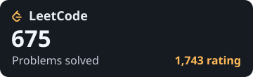</a> &nbsp; <a href="https://codeforces.com/profile/samarth270320076">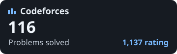</a> 
  <a href="https://www.geeksforgeeks.org/profile/samarthpr59yb?tab=activity">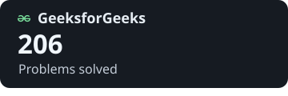</a> &nbsp; <a href="https://www.hackerrank.com/profile/samarthprabhu201">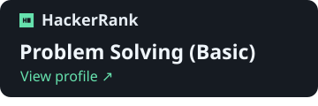</a>

Snapshot · 9 Nov 2026 · [View my C++ solutions ↗](https://github.com/samarthprabhu2007-art/DSA) · [HackerRank certificate ↗](https://myportfolio-lyart-mu-32.vercel.app/photos/Hacker%20rank%20%29%20problem%20solving%20basic.jpg)

## Selected projects

  <a href="https://github.com/samarthprabhu2007-art/SAMSUNG-HACKATHON-">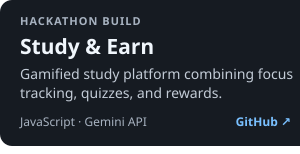</a> &nbsp;
  <a href="https://github.com/samarthprabhu2007-art/C_pbl">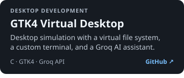</a> 
  <a href="https://github.com/samarthprabhu2007-art/Cookmate-Ai">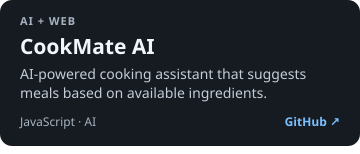</a> &nbsp;
  <a href="https://github.com/samarthprabhu2007-art/AIEL_busbunchingmodelforbmtcbuses">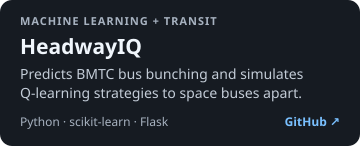</a> 
  <a href="https://github.com/samarthprabhu2007-art/Idea-lab">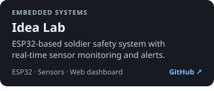</a> &nbsp;
  <a href="https://github.com/samarthprabhu2007-art/BILL_GUARD">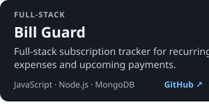</a>

<a href="https://github.com/samarthprabhu2007-art?tab=repositories">Explore all repositories ↗</a>

## Achievements & Certifications

### Featured Achievements

- 🥇 **1st Place · SheSafe Hackathon** — Portable hidden-camera detector. [Project](https://github.com/samarthprabhu2007-art/SHE_SAFE) · [Certificate](https://myportfolio-lyart-mu-32.vercel.app/photos/she_safe_1st_place.jpg)
- **National Finalist · VISION 2047 Hackathon** — Karnataka Edition, FlairX Networks & AICTE. [Certificate](https://myportfolio-lyart-mu-32.vercel.app/photos/vision_2047_hackthon_National_hackathon_final.jpg)
- 🥈 **2nd Place · Gotta Train ’Em All** — XGBoost Pokémon prediction challenge. [Solution](https://github.com/samarthprabhu2007-art/Gotta-Train-Em-All) · [Participation certificate](./assets/certificates/gotta-train-em-all.png)

### Competitive programming

- **4th Place · RV Code League** — Inaugural RVCE competitive programming contest. [Results](https://www.linkedin.com/posts/sagarbm_rvce-rvcodeleague-competitiveprogramming-activity-7470488412299542528-j0hG)
- **6th Rank · CodePulse** — Coding Club RVCE. [Certificate](https://myportfolio-lyart-mu-32.vercel.app/photos/Code_pulse_6th_rank.jpg)
- **Top 16 · CodeQuest 2026** — 4th among 150 in the HackerRank round. [Certificate](https://myportfolio-lyart-mu-32.vercel.app/photos/Code_quest_top_16.jpg)

### Courses & Certifications

- **MERN Stack Web Development Boot Camp** · Coding Club RVCE. [Certificate](https://myportfolio-lyart-mu-32.vercel.app/photos/Mern_stack_web_development_cc.jpg)
- **5-Day AI Agents Intensive Course** · Google and Kaggle. [Certificate](https://myportfolio-lyart-mu-32.vercel.app/photos/Kaggle_google_5_day_ai_agents.png)

## Connect

 &nbsp;
 &nbsp;

---

Samarth Prabhu · RVCE ’29 · Built one project at a time.

